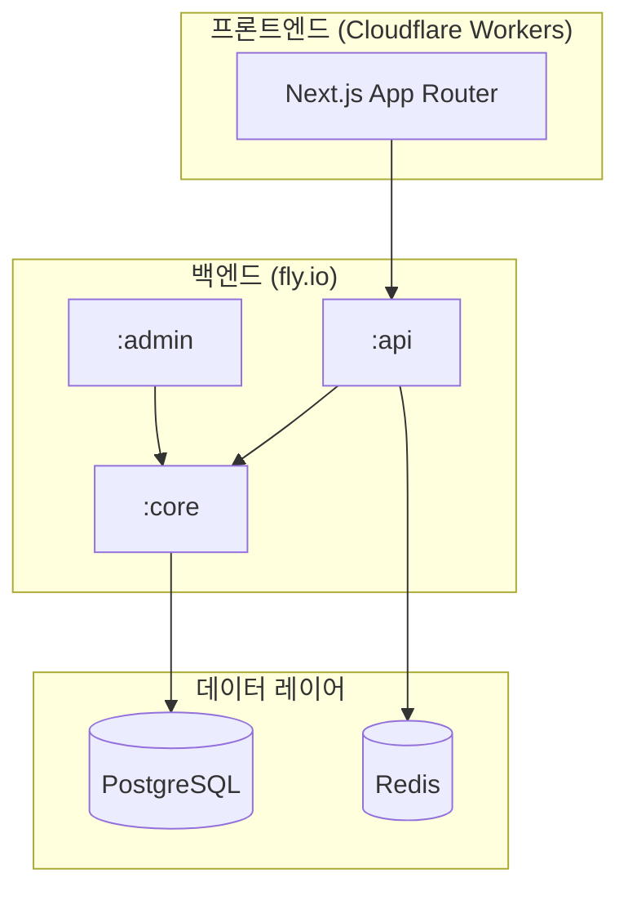

[🇺🇸 English](README.md)

# Bias Song Finder

> 스무고개 방식의 퀴즈로 기억 속 K-pop 노래를 찾아주는 앱

**Live**: https://biassongfinder.com

공개 아티스트 설정에는 **SHINee**와 **f(x)**가 포함되며, 실제 이용 가능 여부는 백엔드에서 불러옵니다.

이 레포지토리는 애플리케이션의 아키텍처와 기술적 의사결정을 정리한 포트폴리오입니다. 구현 코드는 별도 레포지토리에서 관리합니다. 문서는 **2026-10-30**에 확인한 로컬 구현 스냅샷 기준입니다. [소스 기준](docs/ko/engineering-decisions.md#소스-기준)을 함께 기재했습니다.

---

## 개요

사용자가 어렴풋이 기억하는 노래에 대한 질문들 — 인트로를 부르는 멤버, 분위기, 뮤직비디오 유무, 활동 시기 등 — 에 답하면, 앱이 후보곡을 좁혀가며 최종적으로 해당 곡을 찾아줍니다.

백엔드는 답변을 기반으로 후보곡을 필터링하고, 가장 효과적으로 후보를 구분할 수 있는 다음 질문을 동적으로 선택하여, 후보가 하나로 좁혀지면 결과를 반환합니다.

---

## 기술 스택

| 레이어 | 기술 |
|-------|-----------|
| **백엔드** | Kotlin 2.4 / Spring Boot 4.1 / Java 21 |
| **데이터베이스** | PostgreSQL 17 (schema-per-tenant 멀티테넌시) |
| **캐시 / 세션** | Redis (Upstash) |
| **백엔드 배포** | fly.io (dev + prod) |
| **프론트엔드** | Next.js 16 (App Router) / TypeScript 6 / React 19 |
| **UI** | Tailwind CSS v4 / shadcn/ui / Framer Motion |
| **상태 관리** | Zustand |
| **다국어** | 커스텀 구현 (한국어 / 영어) |
| **프론트엔드 배포** | Cloudflare Workers (OpenNext) |

---

## 아키텍처

### 주요 설계 포인트

- **모듈 경계**: HTTP 어댑터, 도메인 서비스, 인프라의 책임을 나누고 질문 선택·답변 처리·결과 조립을 분리
- **멀티테넌시**: 아티스트 카탈로그를 PostgreSQL 스키마로 분리하고 다중 레이어 테넌트 해석 적용
- **세션 기반 게임 플로우**: 로그인 불필요. 경량 세션 메커니즘으로 사용자 계정 없이 퀴즈 상태 추적
- **유사도 기반 폴백**: 한 곡으로 좁혀지지 않을 때 가중 유사도 엔진으로 가장 가까운 곡을 추천
- **복구 가능한 퀴즈 흐름**: 질문이 소진되면 마지막 질문을 다시 열어 답변 재선택 가능
- **일관된 상태 변경**: Redis 버전 비교로 충돌하는 답변을 거부하고, 데이터베이스 잠금과 고유 제약으로 활성 결과 중복 생성 방지
- **엣지 배포**: 프론트엔드를 Cloudflare Workers에서 실행하여 글로벌 저지연 서비스 제공

---

## 문서

- [기술적 의사결정](docs/ko/engineering-decisions.md) — 동시성, 복구, 직렬화 호환성, 요청 경계
- [아키텍처](docs/ko/architecture.md) — 시스템 설계, 모듈 구조, 멀티테넌시
- [백엔드](docs/ko/backend.md) — 백엔드 기술 스택 상세
- [프론트엔드](docs/ko/frontend.md) — 프론트엔드 기술 스택 상세
- [도메인 모델](docs/ko/domain-model.md) — 엔티티와 관계
- [API 개요](docs/ko/api-overview.md) — 세션 플로우와 API 설계 철학
