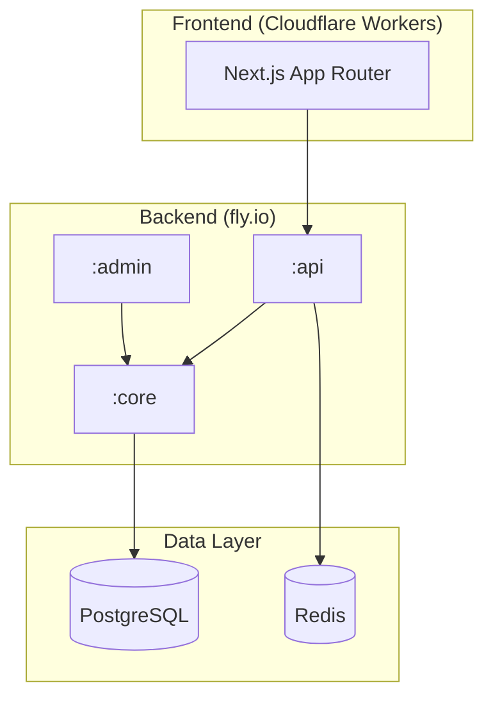

[🇰🇷 한국어](README.ko.md)

# Bias Song Finder

> K-pop song search app using a 20-questions-style quiz to find that half-remembered song.

**Live**: https://biassongfinder.com

Public artist configuration includes **SHINee** and **f(x)**; availability is loaded from the backend.

This repository documents the architecture and engineering decisions of the application. The implementation is maintained in separate repositories. Documentation was reviewed against local implementation snapshots on **2026-10-30**; see the [source baseline](docs/engineering-decisions.md#source-baseline).

---

## Overview

Users answer a series of questions about a song they vaguely remember — the member who sings the intro, the mood, whether it has a music video, the era — and the app narrows down candidates until it finds the song.

The backend filters candidates based on answers, selects the next most-differentiating question dynamically, and returns a result when only one candidate remains.

---

## Tech Stack

| Layer | Technology |
|-------|-----------|
| **Backend** | Kotlin 2.4 / Spring Boot 4.1 / Java 21 |
| **Database** | PostgreSQL 17 (schema-per-tenant multi-tenancy) |
| **Cache / Session** | Redis (Upstash) |
| **Backend Deploy** | fly.io (dev + prod) |
| **Frontend** | Next.js 16 (App Router) / TypeScript 6 / React 19 |
| **UI** | Tailwind CSS v4 / shadcn/ui / Framer Motion |
| **State** | Zustand |
| **i18n** | Custom (Korean / English) |
| **Frontend Deploy** | Cloudflare Workers (OpenNext) |

---

## Architecture

### Key Design Points

- **Module boundaries**: HTTP adapters, domain services, and infrastructure have distinct responsibilities; question selection, answer processing, and result assembly are separated
- **Multi-Tenancy**: Artist catalogs use separate PostgreSQL schemas with multi-layer tenant resolution
- **Session-based game flow**: No login required. A lightweight session mechanism tracks quiz state without user accounts
- **Similarity-based fallback**: When the quiz can't pin a single song, the backend recommends the closest matches via a weighted similarity engine
- **Recoverable quiz flow**: When questions run out, users can reopen the last question and choose a different answer
- **Consistent state changes**: Versioned Redis updates reject conflicting answers, while database locks and a uniqueness constraint prevent duplicate active results
- **Edge deployment**: Frontend runs on Cloudflare Workers for global low-latency delivery

---

## Documentation

- [Engineering Decisions](docs/engineering-decisions.md) — Concurrency, recovery, serialization compatibility, and request boundaries
- [Architecture](docs/architecture.md) — System design, module structure, multi-tenancy
- [Backend](docs/backend.md) — Backend tech stack details
- [Frontend](docs/frontend.md) — Frontend tech stack details
- [Domain Model](docs/domain-model.md) — Entities and relationships
- [API Overview](docs/api-overview.md) — Session flow and API design philosophy
